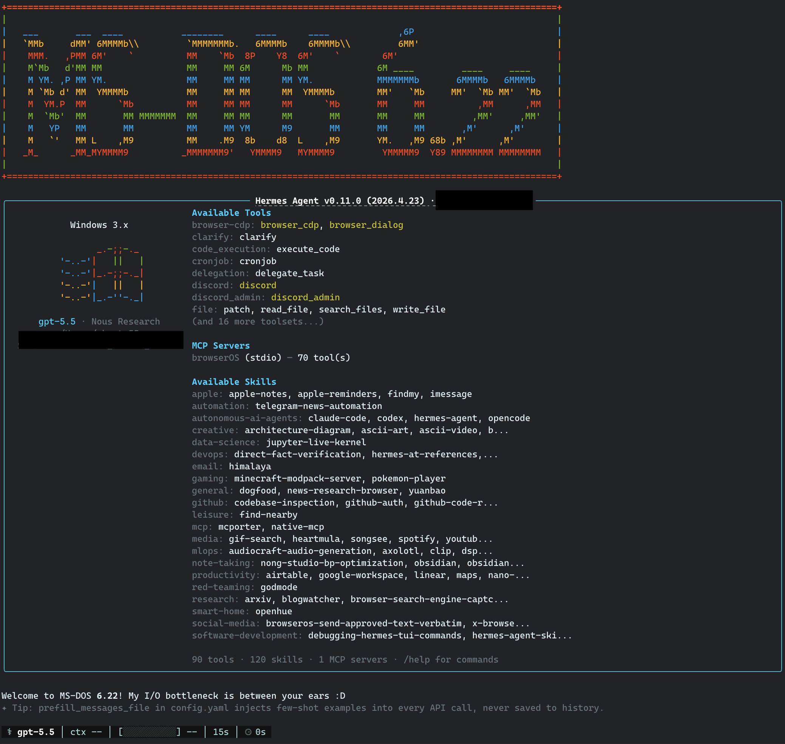

# Hermes Ghost Theme

A custom Hermes Agent CLI/TUI theme with two variants: `mono-ghost` and `mono-ghost-tui`.

It is a dark, high-contrast terminal skin with cyan accents, a retro MS-DOS / Windows 3.x banner, and minimal spinner styling.

## Preview



## Files

```text
skins/mono-ghost.yaml
skins/mono-ghost-tui.yaml
assets/preview.png
```

### `skins/mono-ghost.yaml`

The original Hermes Agent skin file.

Best for the classic CLI view or terminals where Rich markup in the banner renders correctly. It keeps the more colorful Windows 3.x hero art.

### `skins/mono-ghost-tui.yaml`

The TUI-safe variant.

Best for Hermes TUI usage when the original Rich-markup hero can wrap, misalign, or render inconsistently. It keeps the same color palette, spinner, branding, and tool styling, but replaces the hero with fixed-width ASCII art for more stable layout.

It also sets `selection_bg: "#2b6f8f"` for a more visible blue-cyan TUI mouse-selection highlight. This does not control Desktop sidebar selection or window translucency.

Both files configure:

- `colors`: CLI banner, prompt, response border, status bar, completion menu, warnings, and error colors.
- `spinner`: waiting / thinking indicators and verbs.
- `branding`: agent welcome text, goodbye text, response label, prompt symbol, and help header.
- `tool_prefix`: prefix used before tool activity lines.
- `tool_emojis`: per-tool emoji overrides. Currently empty.
- `banner_logo`: custom Rich-markup ASCII logo.
- `banner_hero`: Windows 3.x style hero art; colorful Rich markup in `mono-ghost`, fixed-width ASCII in `mono-ghost-tui`.

The preview image shows the theme running in Hermes Agent.

## Install

Copy the skin file you want into your Hermes skins directory:

```bash
mkdir -p ~/.hermes/skins
cp skins/mono-ghost.yaml ~/.hermes/skins/mono-ghost.yaml
# or, for the TUI-safe variant:
cp skins/mono-ghost-tui.yaml ~/.hermes/skins/mono-ghost-tui.yaml
```

Then activate one inside Hermes:

```text
/skin mono-ghost
# or:
/skin mono-ghost-tui
```

To make one your default theme:

```bash
hermes config set display.skin mono-ghost
# or:
hermes config set display.skin mono-ghost-tui
```

Restart Hermes after changing the default config.

## Hermes Desktop: window translucency (macOS)

If the sidebar looks gray or washed out after maximizing the window, adjust **Settings → Appearance → Window Translucency** before changing the skin palette. This symptom was previously reported with this theme, and reducing **Tint** improved the appearance in that setup.

The maintainer's currently saved Desktop settings provide a starting point:

| Setting | Reference value |
| --- | --- |
| Mode (`mode`) | `clear` |
| Tint (`intensity`) | `15` |
| Fade (`fade`) | `0` |
| Material (`material`) | `titlebar` |
| Scope (`scope`) | `sidebar` |

These are reference settings, not a universal fix or a guarantee of identical rendering across Desktop/macOS versions. If the sidebar still looks washed out, lower **Tint to `0`** as a troubleshooting baseline, then adjust to taste. Compare the sidebar in normal and maximized windows, and check again after restarting Desktop.

Apply the changes in the **Desktop settings UI**. On this macOS installation, the saved values are stored in `~/Library/Application Support/Hermes/translucency.json`; this is a Desktop preference file, not part of the skin YAML. Prefer the UI over editing that file directly so the app's saved interface state stays in sync.

Installing this theme does **not** apply these translucency preferences. No skin palette or custom CSS changes are required for this adjustment, so the existing CLI/TUI appearance can remain unchanged.

## Follow me on Twitter

- [@ghosTM55](https://x.com/ghostm55)

## License

This project is source-available for non-commercial use under the
[PolyForm Noncommercial License 1.0.0](./LICENSE).

Commercial use is not permitted without separate written permission.
